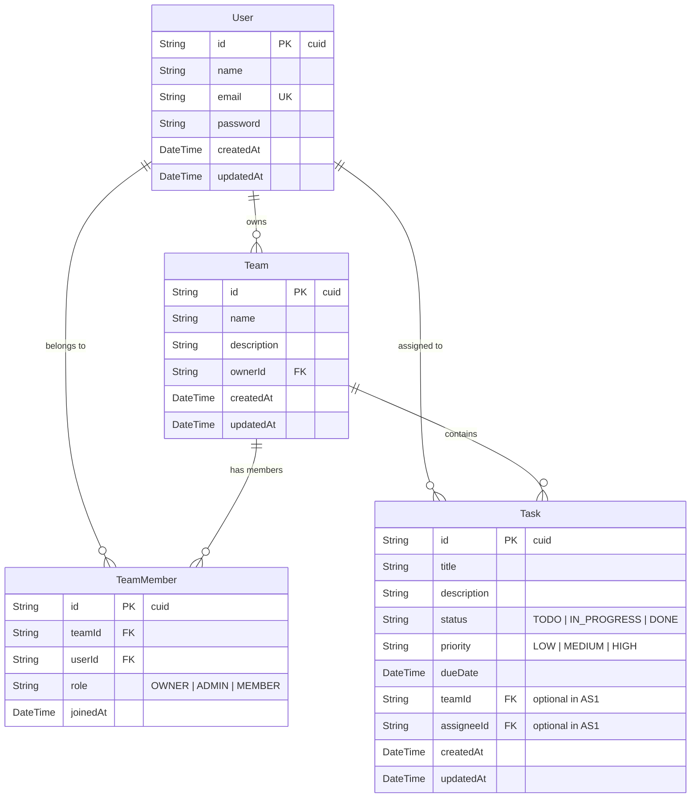

# AuraSync – Task & Team Management Application (Assignment 1)

> **Course**: SDN302 – Web Development with Next.js & Cloud Databases  
> **Student Assignment**: Assignment 1 – Project Setup, Prisma & Deployment  
> **Deployment Platform**: Vercel  
> **Database**: Supabase PostgreSQL  
> **ORM**: Prisma ORM  

---

## 📌 Project Overview

**AuraSync** is a modern task and team management web application built with **Next.js App Router**, **TypeScript**, **Tailwind CSS**, and **Prisma ORM** connected to a cloud **PostgreSQL database hosted on Supabase**.

In this foundational phase (Assignment 1), the application provides:
- **Full Public CRUD** for tasks without requiring authentication.
- **RESTful API Route Handlers** (`GET`, `POST`, `PUT`, `DELETE`).
- **Prisma Data Modeling** with complete schemas for `User`, `Team`, `TeamMember`, and `Task`.
- **Responsive & Modern UI** with search, status filtering, and real-time list updates.
- **CI/CD pipeline** via GitHub Actions.
- **Deployment readiness** for Vercel.

---

## 🏗️ Entity Relationship Diagram (ERD)

The initial Prisma schema models users, teams, memberships, and tasks, preparing the codebase for Assignments 2 and 3:



---

## 🛠️ Tech Stack & Folder Structure

### Technologies
- **Framework**: [Next.js](https://nextjs.org/) (App Router, React 19, TypeScript)
- **Styling**: [Tailwind CSS](https://tailwindcss.com/)
- **Icons**: [Lucide React](https://lucide.dev/)
- **Database**: [Supabase](https://supabase.com/) (PostgreSQL)
- **ORM**: [Prisma ORM](https://www.prisma.io/)
- **CI/CD**: GitHub Actions
- **Hosting**: [Vercel](https://vercel.com/)

### Directory Structure
```text
SDN302_AS1/
├── .github/
│   └── workflows/
│       └── ci.yml              # GitHub Actions CI workflow (lint & build)
├── app/
│   ├── api/
│   │   └── tasks/
│   │       ├── route.ts        # GET /api/tasks & POST /api/tasks
│   │       └── [id]/
│   │           └── route.ts    # PUT /api/tasks/:id & DELETE /api/tasks/:id
│   ├── login/
│   │   └── page.tsx            # Login info & placeholder
│   ├── teams/
│   │   └── page.tsx            # Assignment 2 preview page
│   ├── globals.css             # Tailwind CSS & design variables
│   ├── layout.tsx              # Root layout with Navbar and Footer
│   └── page.tsx                # Homepage with Task Board & CRUD
├── components/
│   ├── Footer.tsx              # Global footer component
│   ├── Navbar.tsx              # Global navigation header
│   ├── TaskCard.tsx            # Task card component with badges & actions
│   └── TaskModal.tsx           # Create & edit task modal dialog with validation
├── lib/
│   ├── prisma.ts               # PrismaClient singleton instance
│   └── types.ts                # TypeScript interfaces (Task, TaskFormData, etc.)
├── prisma/
│   └── schema.prisma           # Prisma schema with 4 core models
├── .env.example                # Example environment variables template
├── .prettierrc                 # Prettier code formatting rules
├── package.json
└── README.md
```

---

## 🔌 API Route Specifications

| Method | Endpoint | Description | Status Codes |
| :--- | :--- | :--- | :--- |
| `GET` | `/api/tasks` | Returns all tasks ordered by `createdAt desc` | `200`, `500` |
| `POST` | `/api/tasks` | Creates a new task (validates non-empty `title`) | `201`, `400`, `500` |
| `PUT` | `/api/tasks/:id` | Updates task title, description, status, priority, or dueDate | `200`, `400`, `404`, `500` |
| `DELETE` | `/api/tasks/:id` | Deletes a task by ID | `200`, `404`, `500` |

---

## 🚀 Getting Started Locally

### 1. Clone the repository
```bash
git clone <YOUR-GITHUB-REPO-URL>
cd SDN302_AS1
```

### 2. Install dependencies
```bash
npm install --legacy-peer-deps
```

### 3. Configure Environment Variables
Copy `.env.example` to `.env`:
```bash
cp .env.example .env
```
Fill in your Supabase connection strings:
- `DATABASE_URL`: Connection string from Supabase (Transaction pooler, port 6543)
- `DIRECT_URL`: Direct database connection string (Session / port 5432)

### 4. Run Prisma Migration
Apply the database schema to your Supabase PostgreSQL instance:
```bash
npx prisma migrate dev --name init
```

*(Optional) Launch Prisma Studio to visually browse and manage database rows:*
```bash
npx prisma studio
```

### 5. Start the Development Server
```bash
npm run dev
```
Open [http://localhost:3000](http://localhost:3000) in your browser.

---

## ☁️ Deployment on Vercel

1. Push your repository to **GitHub**.
2. Go to **[vercel.com](https://vercel.com/)** and import your GitHub repository.
3. In the project settings, under **Environment Variables**, add:
   - `DATABASE_URL`: Your Supabase connection string.
   - `DIRECT_URL`: Your Supabase direct connection string.
4. Click **Deploy**. Vercel will automatically run `npm run build` (which includes `prisma generate`).

---

## 🌟 Assignment Deliverables Checklist

### Assignment 1 & 2
- [x] Next.js App Router project initialized with TypeScript and Tailwind CSS.
- [x] Authentication with NextAuth.js (credentials provider & bcrypt hashing).
- [x] Full team workspaces CRUD and member invitations.
- [x] Public & Team Kanban Task Boards.

### Assignment 3 & 4 (Real-time Collaboration & Advanced Features)
- [x] **Real-time Team Chat**:
  - Each team has a dedicated chat room.
  - Persisted message history (`Message` model in PostgreSQL via Prisma).
  - Instant live messaging without page refresh across all online members.
  - Unified real-time support (Pusher, Supabase Realtime, and smart SSE / polling fallback).
  - **Bonus**: Real-time typing indicators ("Alice is typing...").
  - **Bonus**: Image & file attachments in chat messages.
- [x] **Live Task Board Updates (Real-time Kanban)**:
  - Instant live updates across teammates when tasks are created, updated, dragged, or deleted.
  - Optimistic UI updates with zero-delay collaboration.
- [x] **Notification System**:
  - In-app notification bell with live unread badge count.
  - Triggered on task assignment and team invitation.
  - Mark single / mark all notifications as read.
  - **Bonus**: Browser desktop push notification support (`Notification API`).
- [x] **Advanced Role & Permission System (RBAC)**:
  - **Owner**: Full control (manage members, change roles, delete team, delete any task, edit settings).
  - **Admin**: Can manage members & roles (Member <-> Admin), create/edit/delete all tasks. Cannot delete the team.
  - **Member**: Can create tasks, edit and manage their assigned tasks & status, participate in team chat. Cannot delete other members' tasks or manage team members.
  - Enforced strictly on both client UI and server API route handlers.
- [x] **Bonus: Team Activity Audit Trail**:
  - Full audit trail logging who created, updated, or deleted tasks, invited members, or changed roles.
  - Live activity log feed in team workspace.

---

## 📝 Submission Information

> Fill in the fields below exactly as labeled, on their own line. Leave a field as "N/A" if it does not apply to you.

Student ID: __________  
Full Name: __________  
GitHub Repository URL: __________  
Deployed Website URL (Vercel): __________  
Separate Backend URL (NestJS on Render) — write N/A if not used: N/A  
Real-time mechanism used (Supabase Realtime / Socket.io / Pusher / Ably): Supabase Realtime  
Test Account 1 Email: __________  
Test Account 1 Password: __________  
Test Account 2 Email (must be on the SAME team as Account 1, to test real-time between two sessions): __________  
Test Account 2 Password: __________  
Both test accounts are already email-verified / ready to log in immediately, with no confirmation link needed (Yes / No): Yes  
Demo video link (YouTube/Drive/Loom, 2–3 minutes, showing live chat and live task updates across two sessions): __________  

